# Multi-Label Chest Pathology XAI

I built this as a 14-class chest X-ray classifier on NIH ChestX-ray14, with a
HiResCAM explanation for every prediction and a FastAPI backend behind a React
workspace called Chest X-Ray Studio. The model is a ConvNeXt-Base trained at
384×384 on a patient-level 70/10/10 split; the finished run reached **0.8568
test AUROC / 0.3061 test AUPRC** on 11,195 held-out images. The split is by
patient ID, the decision thresholds are tuned on validation only, and the
explanation is the published HiResCAM form, `ReLU(sum(grad * activation))`.
The repository also includes a DenseNet-121 demo checkpoint, DICOM-aware
external evaluation, and the training/reporting pipeline used to produce the
numbers below.

[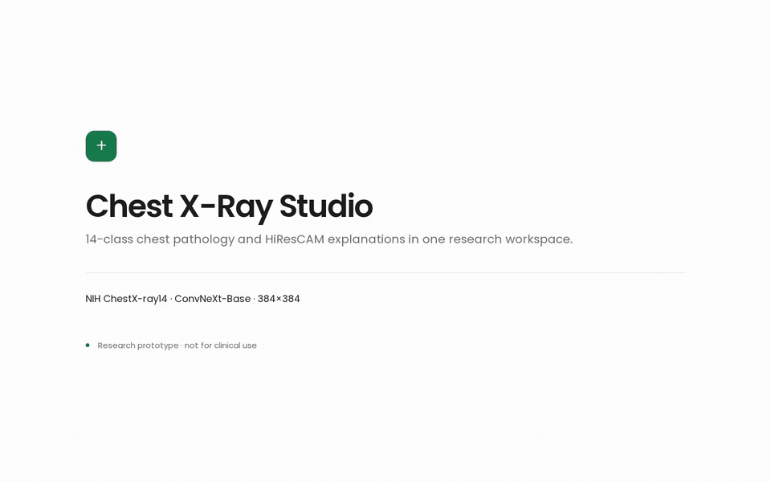](docs/figs/demo.mp4)

_Silent 16-second demo. The interface is shown with a real held-out test image;
the final card reports the test metrics. The full-quality MP4 is
[`docs/figs/demo.mp4`](docs/figs/demo.mp4)._

> **Research prototype.** Not a medical device and not for clinical use.

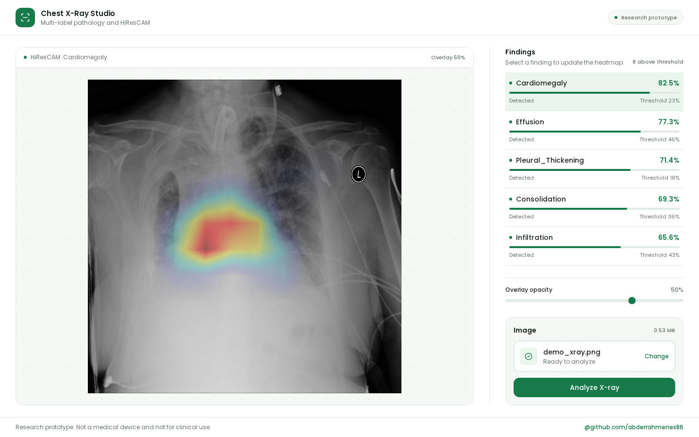

_The white-and-green workspace after analyzing a held-out test image. The
finding list contains all 14 predictions; the selected class drives the overlay._

## Contents

- [Results](#results)
- [Dataset](#dataset)
- [Training vs held-out test examples](#training-vs-held-out-test-examples)
- [Requirements](#requirements)
- [Reproduce](#reproduce)
- [How it works](#how-it-works)
- [Configuration](#configuration)
- [External evaluation](#external-evaluation)
- [Project layout](#project-layout)
- [Limits](#limits)
- [Citation](#citation)
- [Stack](#stack)

## Results

### Current 70/10/10 run

The finished ConvNeXt-Base run was trained on the current patient-level split.
The test set was not used for training or threshold tuning.

| Model | Parameters | Resolution | Best val AUROC | Best val AUPRC | Test AUROC | Test AUPRC | Epochs |
|---|---:|---:|---:|---:|---:|---:|---:|
| ConvNeXt-Base | 87.6 M | 384×384 | 0.8602 (epoch 7) | 0.2854 (epoch 6) | **0.8568** | **0.3061** | 11, early stop |

- 89,704 training images / 11,221 validation / 11,195 held-out test images
- 24,645 training patients / 3,080 validation / 3,080 test patients
- Test AUROC and AUPRC are macro averages across the 14 classes
- Test metrics use per-class thresholds tuned on validation only
- Hardware: RTX 3090 24 GB, bf16 autocast, 12 dataloader workers, train/validation RAM cache
- Training wall time to the epoch-11 stop: about 2 h 27 min

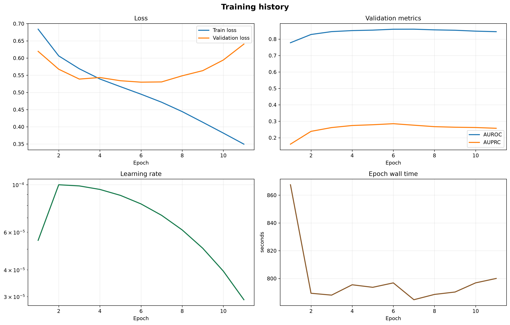

_Training history. The best validation AUROC was epoch 7; epochs 8–11 did not
improve it._

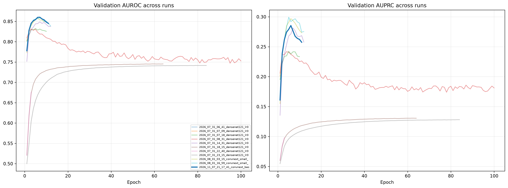

_Current run against the earlier 80/20 experiments. The historical runs used a
different split and are shown for context, not as a controlled comparison._

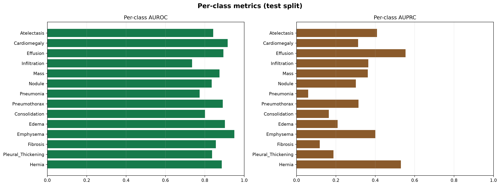

_Macro test AUROC is 0.8568 and macro AUPRC is 0.3061. Infiltration and
Pneumonia remain the weakest classes, which is consistent with the label noise
and class imbalance in the dataset._

<details>
<summary>Per-class test metrics</summary>

| Class | AUROC | AUPRC | Threshold |
|---|---:|---:|---:|
| Atelectasis | 0.8425 | 0.4089 | 0.41 |
| Cardiomegaly | 0.9159 | 0.3128 | 0.23 |
| Effusion | 0.8945 | 0.5538 | 0.46 |
| Infiltration | 0.7354 | 0.3643 | 0.43 |
| Mass | 0.8747 | 0.3619 | 0.22 |
| Nodule | 0.8353 | 0.3016 | 0.28 |
| Pneumonia | 0.7736 | 0.0591 | 0.05 |
| Pneumothorax | 0.8911 | 0.3147 | 0.18 |
| Consolidation | 0.8014 | 0.1641 | 0.36 |
| Edema | 0.9022 | 0.2090 | 0.15 |
| Emphysema | 0.9499 | 0.4003 | 0.07 |
| Fibrosis | 0.8559 | 0.1181 | 0.12 |
| Pleural_Thickening | 0.8367 | 0.1878 | 0.18 |
| Hernia | 0.8859 | 0.5299 | 0.08 |

</details>

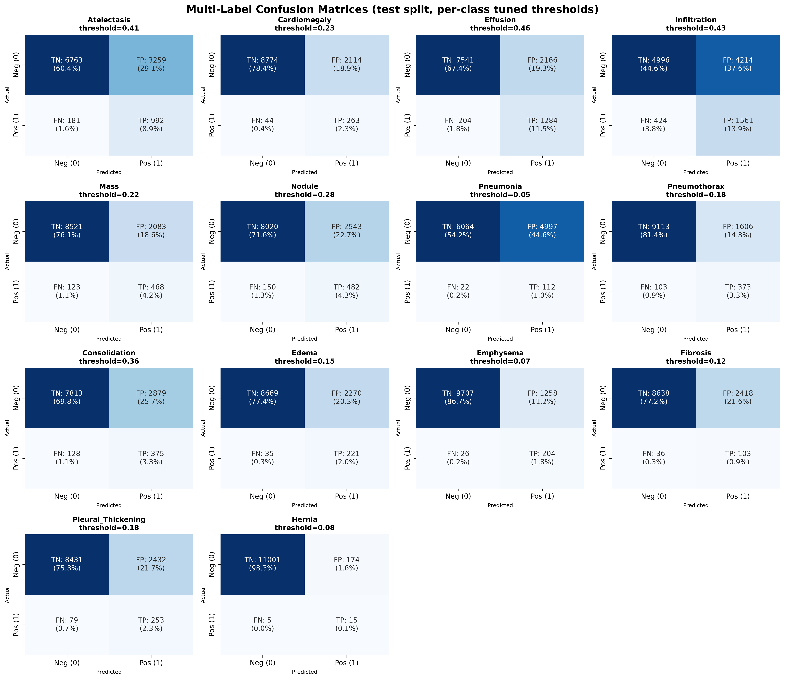

_Test confusion matrices use the per-class thresholds above, not a fixed 0.50
threshold._

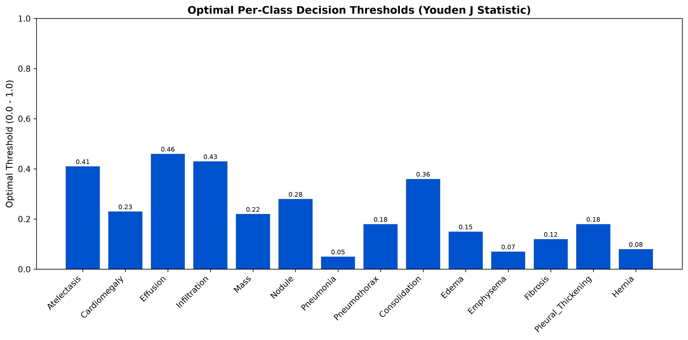

_Thresholds are selected on the validation split with Youden's J. The low
Pneumonia threshold reflects its low prevalence and weak separation._

<details>
<summary>ROC and precision-recall curves</summary>

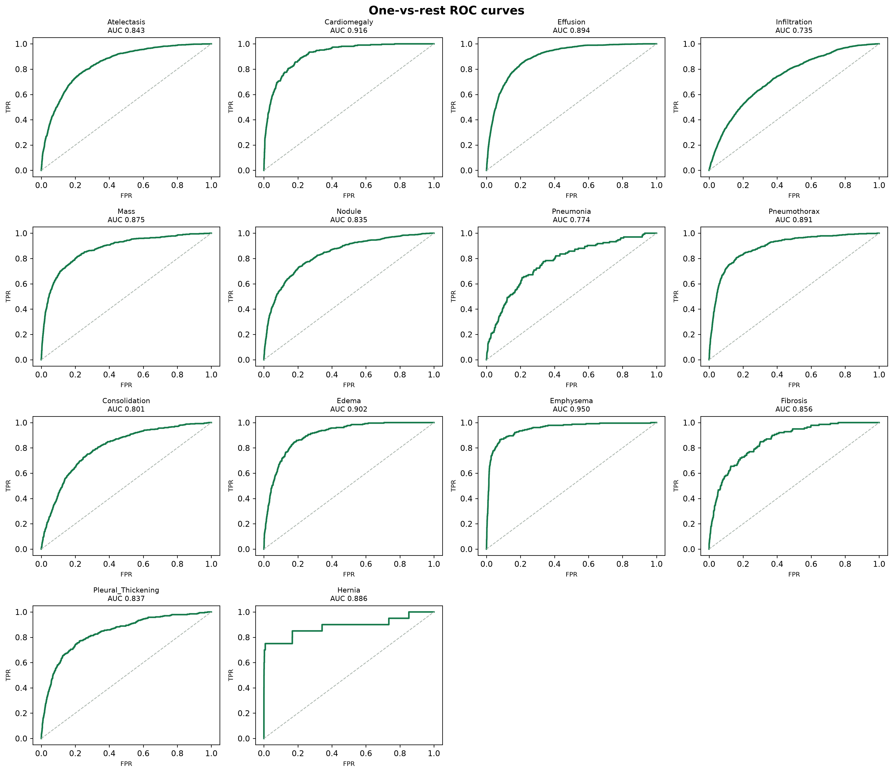

_One-vs-rest ROC curves on the held-out test split._

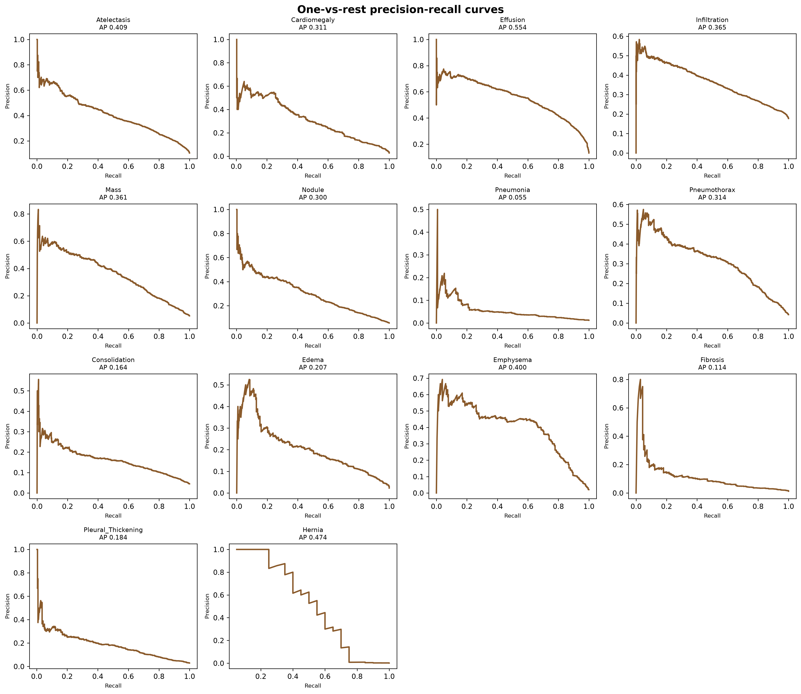

_One-vs-rest precision-recall curves on the held-out test split. Rare classes
have low baselines and low AP; the curves are more informative than the macro
AUPRC alone._

</details>

### Historical 80/20 runs

| Model | Parameters | Resolution | Peak val AUROC | Peak val AUPRC |
|---|---:|---:|---:|---:|
| ConvNeXt-Small | 49.47 M | 448×448 | 0.8583 | 0.2992 |
| DenseNet-121 | 6.97 M | 320×320 | 0.8488 | 0.2812 |

These are from an earlier 80/20 patient split and are not directly comparable
to the current test results. The 0.8583 AUROC is epoch 7 of the 448×448
ConvNeXt-Small run; its AUPRC at that epoch is 0.2948, and 0.2992 is that run's
peak AUPRC.

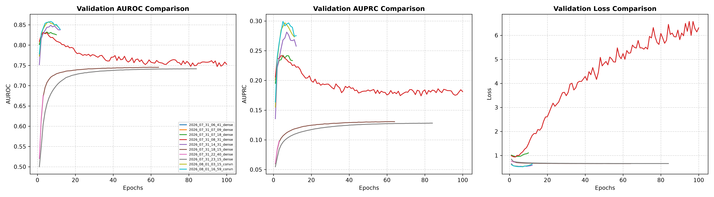

_Validation curves from the saved 80/20 experiments. Several runs are included
because early stopping and batch-size changes produced different trajectories._

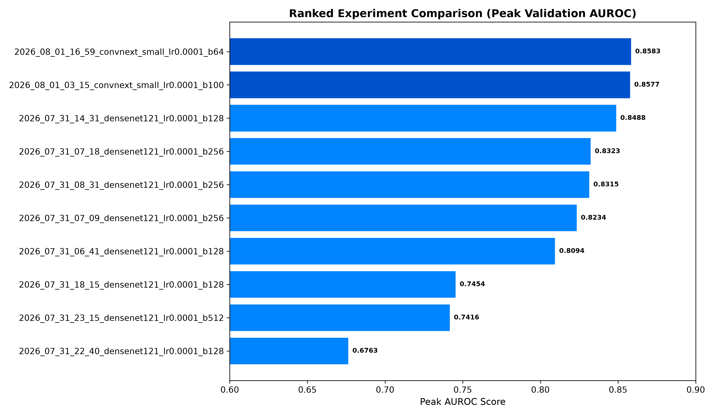

_Peak validation AUROC by run. The comparison is descriptive; the runs differ in
resolution and batch size._

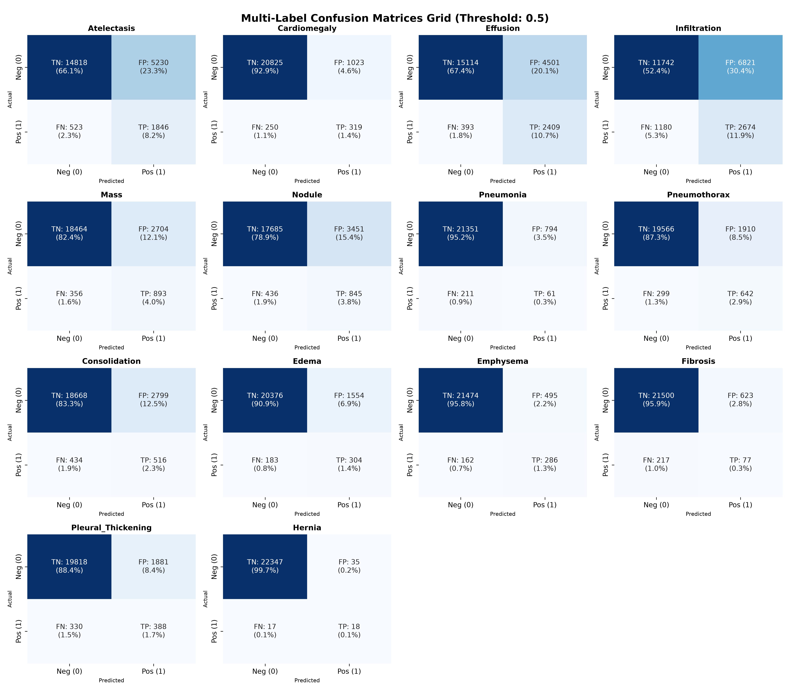

_Historical 80/20 validation confusion matrices at a fixed 0.50 threshold._

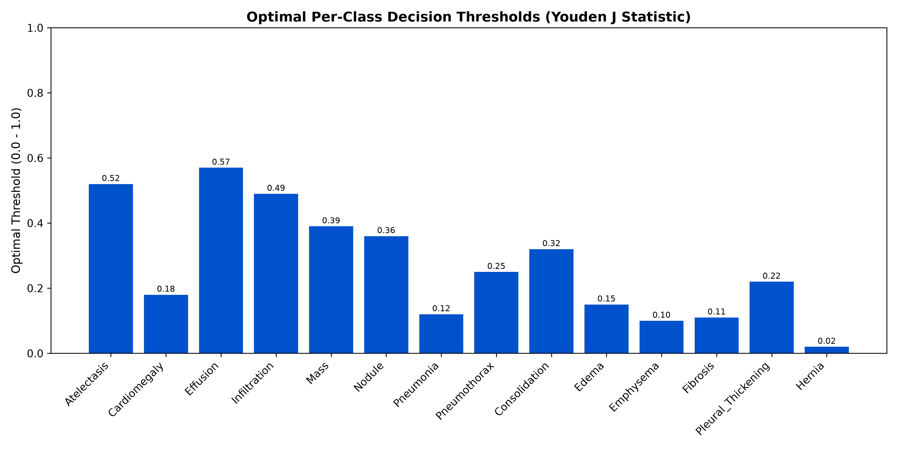

_Historical per-class thresholds from an earlier run. The current run uses the
thresholds shown in the 70/10/10 section above._

CheXNet reports 0.841 mean AUROC on the official NIH test list. The numbers here
come from a random patient split, so that comparison is only a rough reference.

## Dataset

The dataset is **NIH ChestX-ray14**, released by the NIH Clinical Center:
112,120 frontal radiographs from 30,805 patients. It has 14 text-mined labels:
Atelectasis, Cardiomegaly, Effusion, Infiltration, Mass, Nodule, Pneumonia,
Pneumothorax, Consolidation, Edema, Emphysema, Fibrosis, Pleural Thickening,
and Hernia. The labels come from radiology reports, so they are noisy.

I use a patient-level 70/10/10 split. The official image-level split is not used
because it contains patient overlap. The split and the per-class counts are
written into every run as `split.json` and `split_stats.json`.

- Kaggle mirror used by the code:
  <https://www.kaggle.com/datasets/nih-chest-xrays/data>
  (CLI slug `nih-chest-xrays/data`)
- Original NIH release: <https://nihcc.app.box.com/v/ChestXray-NIHCC>
- Paper: Wang et al., "ChestX-ray8: Hospital-scale Chest X-ray Database and
  Benchmarks on Weakly-Supervised Classification and Localization of Common
  Thorax Diseases," CVPR 2017.

```bash
python -m src.train --download-only
```

The downloader expects the Kaggle CLI and `~/.kaggle/kaggle.json`; it downloads,
extracts, and flattens the archives into `data/images/`. Expect about 42 GB of
free disk space.

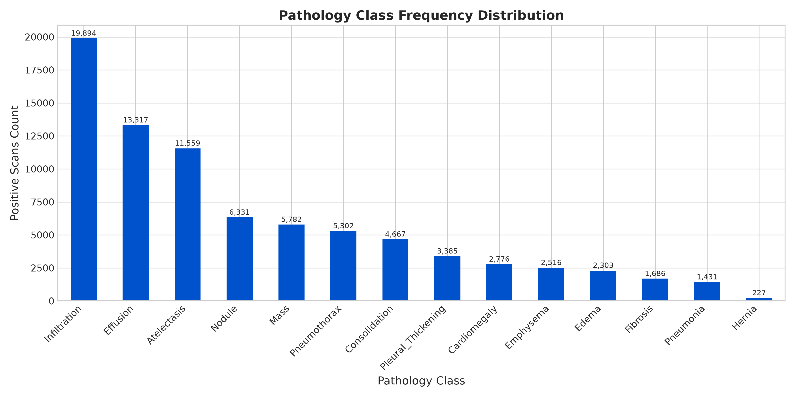

_Label frequency across the full dataset. The dataset is multi-label, so the
counts do not sum to 112,120._

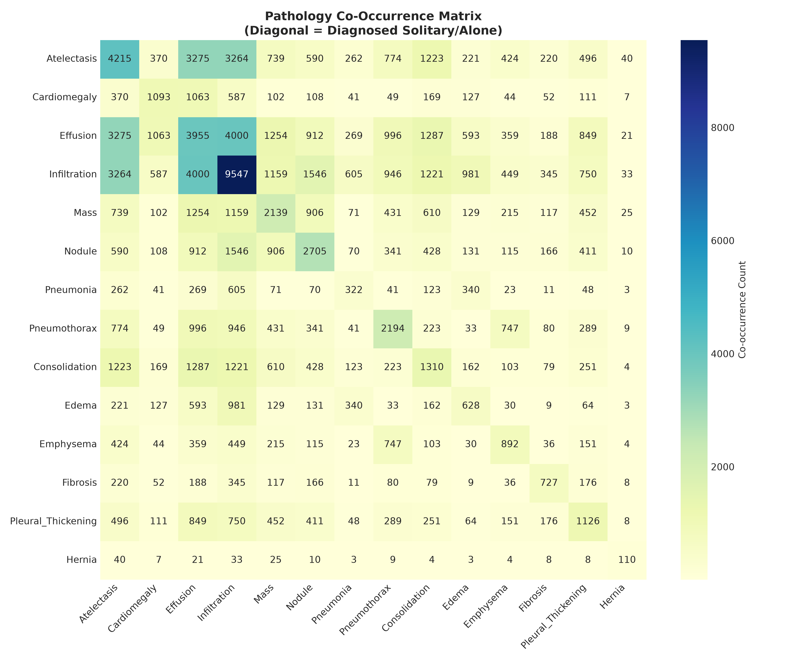

_Co-occurrence counts. The diagonal isolates diagnoses recorded alone._

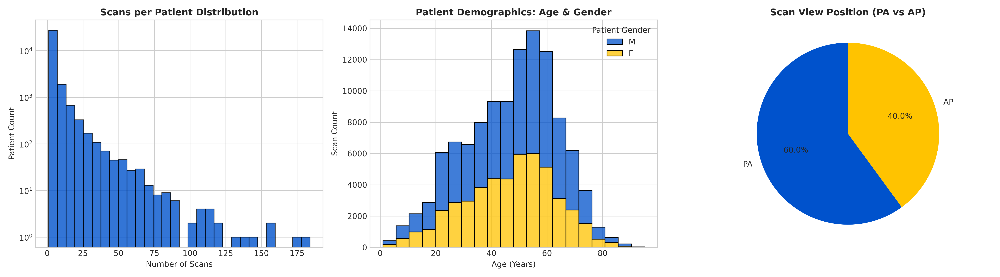

_Scans per patient, age and gender distribution, and PA/AP view mix. The model
does not use any of this metadata as input; these plots describe the dataset,
not model behavior._

## Training vs held-out test examples

Each image below is a side-by-side pair: the original radiograph on the left and
the HiResCAM overlay on the right. Training examples were seen during training;
the held-out examples come from patients in the test split.

### Training split

| Effusion (91.4%) | Mass (93.9%) |
|---|---|
| 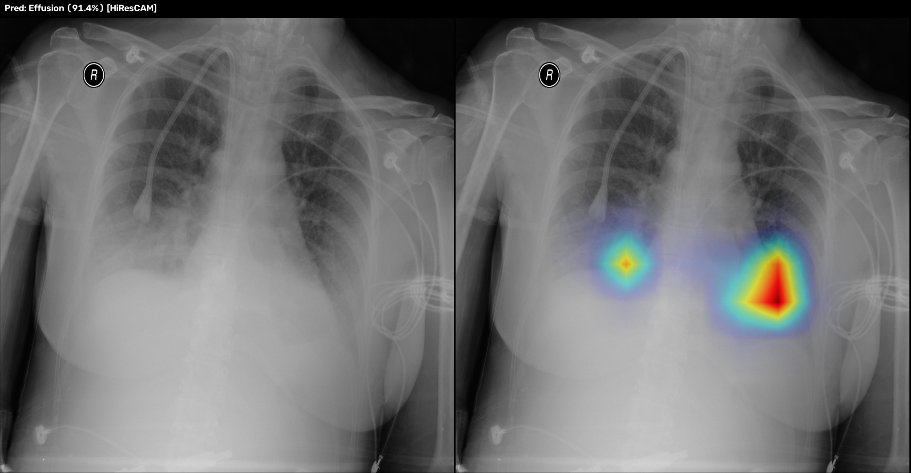 | 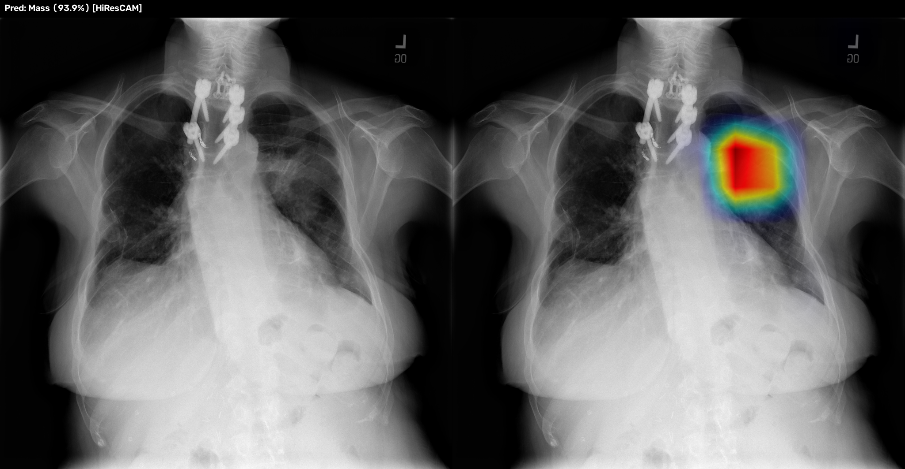 |

### Held-out test split

| Cardiomegaly (82.5%) | Infiltration (86.8%) |
|---|---|
| 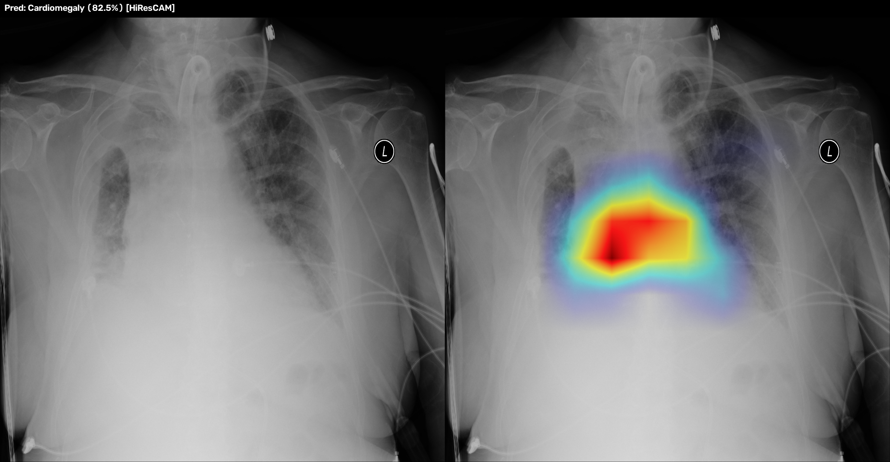 | 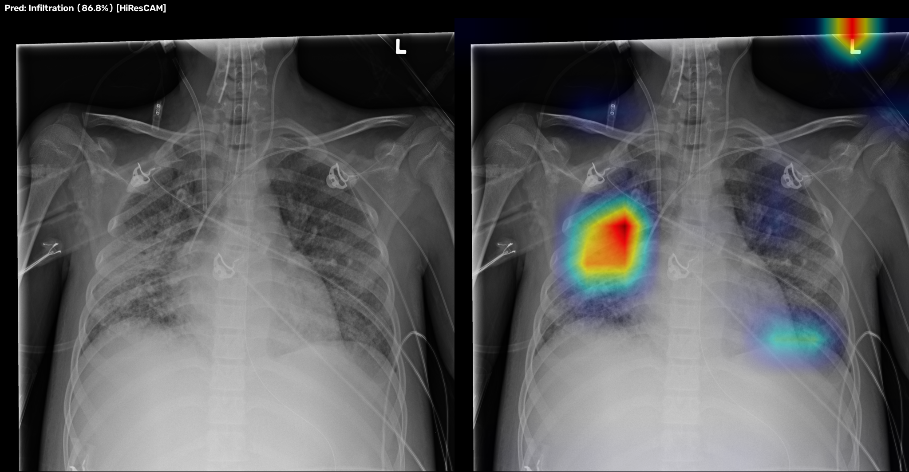 |

The remaining historical overlays are in `docs/figs/`:
[Extensive effusion example](docs/figs/00012841_000_Effusion.png),
[infiltration](docs/figs/00014613_001_Infiltration.png),
[mass](docs/figs/00009305_001_Mass.png),
[atelectasis](docs/figs/00011702_006_Atelectasis.png),
[edema](docs/figs/00012863_008_Edema.png),
[emphysema](docs/figs/00016064_004_Emphysema.png),
[infiltration](docs/figs/00000181_011_Infiltration.png),
[effusion A](docs/figs/00001684_023_Effusion.png),
[effusion B](docs/figs/00012834_008_Effusion.png),
and [effusion C](docs/figs/00020703_027_Effusion.png).

## Requirements

- Python 3.10 or newer. The code uses `X | Y` annotations and modern
  `from __future__` syntax.
- PyTorch 2.3 or newer and torchvision 0.18 or newer. The finished run used
  torch 2.14.1 + CUDA 13.2.
- Node 22.12 or newer for Vite 8 and the React workspace.
- An RTX 3090 24 GB for the training configuration below. CPU inference works;
  it is slower but uses the same code path.
- About 42 GB of disk for the dataset and its extracted images, plus about
  1.2 GB per ConvNeXt-Base run directory.
- The Kaggle CLI for the dataset. `pydicom` is used by the external evaluator.

## Reproduce

### Weights

The repository includes a DenseNet-121 demo checkpoint at
`checkpoints/densenet121/`. The finished ConvNeXt-Base checkpoint is
`artifacts/2026_11_07_21_17_41_convnext_base_lr0.0001_b32_a2_r384x384_s42/best.pth`
and is not committed because `artifacts/` is ignored.

```bash
python -m backend.main \
  --run artifacts/2026_11_07_21_17_41_convnext_base_lr0.0001_b32_a2_r384x384_s42 \
  --host 127.0.0.1 --port 8000
```

The model loader reads the architecture and input resolution from
`hyperparameters.json` and does not download ImageNet weights at inference time.

### Train

```bash
python -m src.train \
  --architecture convnext_base \
  --width 384 --height 384 \
  --batch 32 --accumulate 2 \
  --workers 12 --prefetch 4 \
  --cache --cache-val --cache-workers 16 \
  --val-batch 64 \
  --epochs 16 --patience 4 \
  --val-fraction 0.1 --test-fraction 0.1
```

The effective batch is 64. The train cache is about 32 GiB at 384×384; validation
adds about 5 GiB. The finished run early-stopped after epoch 11. A full 16-epoch
run took about 3.5 h on the 3090; the 11-epoch run took about 2 h 27 min.

The default parser also supports `--architecture convnext_small`, `convnext_tiny`,
`convnext_base`, `convnext_large`, `densenet121`, and the other torchvision
backbones listed in `src/model.py`.

### Evaluate

```bash
python -m src.find --run artifacts/<run>
python -m src.evaluate --run artifacts/<run> --split test
python -m src.conf_matrices --run artifacts/<run> --split test
python -m src.report --run artifacts/<run>
```

`src.evaluate` writes `per_class_metrics_test.json` and
`predictions_test.npz`; `src.report` uses the saved predictions for ROC/PR
curves, per-class plots, comparison curves, and the summary files.

### External evaluation

Training stays on NIH. External datasets are task-specific tests, never extra
14-class labels. The external evaluator supports:

| Dataset | Label used | Kaggle access |
|---|---|---|
| SIIM-ACR Pneumothorax | `Pneumothorax` | Competition `siim-acr-pneumothorax-segmentation` |
| RSNA Pneumonia | `Pneumonia` | Competition `rsna-pneumonia-detection-challenge` |
| Pediatric pneumonia | `Pneumonia` | Dataset `paultimothymooney/chest-xray-pneumonia` |

```bash
kaggle competitions download -c siim-acr-pneumothorax-segmentation
kaggle competitions download -c rsna-pneumonia-detection-challenge
kaggle datasets download -d paultimothymooney/chest-xray-pneumonia

python -m src.evaluate_external \
  --run artifacts/<run> --dataset siim \
  --data-dir data/external/siim --crop-borders
```

RSNA images overlap NIH ChestX-ray14, so RSNA is a pneumonia/localization check,
not an independent cohort. SIIM and the pediatric set evaluate only
pneumothorax and pneumonia. The DICOM reader handles MONOCHROME1 inversion,
rescale/windowing, and optional black-border cropping; corrupt and blank images
are skipped and counted in the output JSON.

## How it works

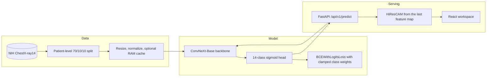

The data path is `src/dataset.py` plus `src/splits.py`. The model is in
`src/model.py`; `src/predictor.py` shares the inference and CAM path between the
API and CLI. The API validates content type, upload size, and image dimensions,
then returns 14 probabilities, the selected target, and an RGBA heatmap. The
frontend lists every prediction, marks which ones clear their tuned threshold,
and lets you select any finding, including one below threshold, to change the
overlay.

## Configuration

### Important training flags

| Flag | Default | What it does |
|---|---:|---|
| `--architecture` | `densenet121` | Torchvision backbone |
| `--width`, `--height` | `320` | Square input resolution |
| `--batch` | `64` | Micro-batch size |
| `--accumulate` | `1` | Gradient accumulation steps; effective batch is `batch * accumulate` |
| `--epochs` | `30` | Maximum epochs |
| `--patience` | `5` | Early-stopping patience on validation AUROC |
| `--val-fraction` | `0.1` | Patient-level validation fraction |
| `--test-fraction` | `0.1` | Patient-level held-out test fraction |
| `--cache` | off | Cache the training split in RAM |
| `--cache-val` | off | Cache the validation split in RAM |
| `--cache-workers` | `8` | Threads used to fill the RAM cache |
| `--val-batch` | `0` | Validation/test batch size; 0 uses `--batch` |
| `--workers` | `8` | DataLoader workers |
| `--prefetch` | `2` | DataLoader prefetch factor |
| `--no-compile` | off | Disable `torch.compile` |
| `--no-pretrained` | off | Skip ImageNet weight download |
| `--resume` | none | Resume from a `last.pth` checkpoint |

### Backend environment variables

| Variable | Default | Purpose |
|---|---|---|
| `CHEST_XAI_RUN` | none | Run directory to serve |
| `CHEST_XAI_ARTIFACTS` | `artifacts` | Run root |
| `CHEST_XAI_CORS_ORIGINS` | `http://localhost:5173,http://127.0.0.1:5173` | Comma-separated allowlist |
| `CHEST_XAI_MAX_UPLOAD_BYTES` | `10485760` | Upload limit in bytes |

### Frontend

| Variable | Default | Purpose |
|---|---|---|
| `VITE_API_URL` | `http://localhost:8000` | Backend base URL |

## Project layout

| Path | Role |
|---|---|
| `backend/main.py` | FastAPI app, health route, upload validation |
| `backend/engine.py` | Run loading and prediction wrapper |
| `checkpoints/densenet121/` | Bundled demo checkpoint |
| `frontend/src/` | React 19 workspace |
| `src/train.py` | Training entry point, split, cache, test evaluation |
| `src/model.py` | Torchvision backbones, ConvNeXt variants, target layer |
| `src/predictor.py` | Shared inference and HiResCAM |
| `src/explain.py` | HiResCAM and CAM normalization |
| `src/splits.py` | Patient-level split |
| `src/evaluate.py` | Per-class metrics and saved predictions |
| `src/find.py` | Youden's J thresholds |
| `src/conf_matrices.py` | Confusion matrices |
| `src/report.py` | Curves, per-class bars, comparison, summary |
| `src/external.py` | SIIM/RSNA/pediatric manifests |
| `src/imaging.py` | DICOM/PNG/JPEG cleaning |
| `src/evaluate_external.py` | External task evaluation CLI |
| `src/download.py` | Kaggle download and extraction |
| `src/compare.py`, `src/plot.py` | Older comparison and curve scripts |
| `tests/` | Python tests for labels, splits, cache, CAM, API, external loaders |

`fetch.sh` and `push.sh` are the local-to-remote helpers used on the Vast GPU
instance. `artifacts/` is intentionally ignored; it holds runs and checkpoints.

## Limits

- Trained and evaluated only on NIH ChestX-ray14. Other scanners, acquisition
  protocols, and populations are untested.
- Labels are mined from reports and are noisy. The model does not segment
  lesions; HiResCAM is a coarse feature-map attribution, not a radiologist
  bounding box.
- AUPRC is low for rare classes. Pneumonia AUPRC is 0.059 and Fibrosis is 0.118
  on the held-out test split.
- The finished run used one seed and one hardware setup. The historical
  comparison is descriptive, not a controlled ablation.
- No calibration analysis, subgroup fairness analysis, or clinical validation is
  included.
- The API accepts PNG/JPEG only. DICOM support exists in the external data path,
  not in the upload endpoint.
- The backend has no authentication, rate limiting, or TLS. Do not expose it
  with patient data.
- The ConvNeXt-Base checkpoint is local under `artifacts/` and is not
  redistributed by the repository. Only the DenseNet-121 demo checkpoint is
  bundled.
- A research prototype, not a diagnostic tool.

## Citation

```bibtex
@inproceedings{wang2017chestxray8,
  title     = {ChestX-ray8: Hospital-scale Chest X-ray Database and Benchmarks on Weakly-Supervised Classification and Localization of Common Thorax Diseases},
  author    = {Wang, Xiaosong and Peng, Yifan and Lu, Le and Lu, Zhiyong and Bagheri, Mohammadhadi and Summers, Ronald M.},
  booktitle = {CVPR},
  year      = {2017}
}
```

The explanation method follows Draelos and Carin, "Use HiResCAM instead of
Grad-CAM for faithful explanations of convolutional neural networks,"
arXiv:2011.08891, 2020.

## Stack

| Layer | Technology |
|---|---|
| Training | PyTorch 2.14, torchvision 0.29, torchmetrics, torchinfo |
| Serving | FastAPI, Uvicorn, Pillow, OpenCV, pydicom |
| Frontend | React 19, Vite 8, Tailwind CSS 4, Poppins |
| Data | NIH ChestX-ray14 via Kaggle |
| Reporting | Matplotlib, NumPy, FFmpeg for the demo video |
