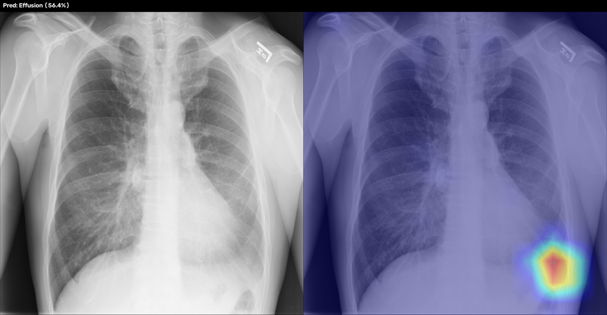
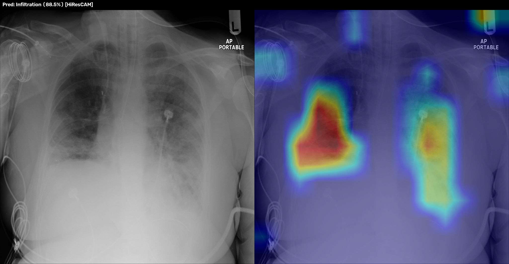

# Multi-Label Chest Pathology XAI

A 14-class chest pathology classifier on NIH ChestX-ray14, with heatmap
explanations for every prediction and a FastAPI backend behind a single-screen
React workspace.


## What it does

- Trains ConvNeXt-Small and DenseNet-121 on 14 pathologies, both at 320x320.
- Produces HiResCAM overlays by multiplying positive gradients with
  activations, so the heatmap lands on the lesion rather than on shoulder
  artifacts or tubing.
- Picks a decision threshold per disease with Youden's J, which matters for rare
  classes such as Hernia at 0.2% prevalence.
- Serves inference from memory through FastAPI, returning the overlay as a
  base64 PNG that the frontend composites over the original X-ray.
- Splits by patient ID, so follow-up scans cannot leak between train and
  validation.

## Results

Validation AUROC on the official NIH split:

| Model | Parameters | Resolution | Peak val AUROC | Peak val AUPRC |
|---|---|---:|---:|---:|
| ConvNeXt-Small | 50.0 M | 320x320 | 0.8583 | 0.2935 |
| DenseNet-121 | 7.0 M | 320x320 | 0.8488 | 0.2812 |

For reference, CheXNet reports 0.841 on the same dataset. The AUPRC numbers are
low because the label distribution is heavily imbalanced; per-class scores are in
[docs/eda.md](docs/eda.md).


## Dataset

NIH ChestX-ray14, 112,120 radiographs from 30,805 patients. The split is by
patient, not by image. Class balance, co-occurrence, and view-position
demographics are in [docs/eda.md](docs/eda.md).

## Explanations


| Finding | Overlay |
|---|---|
| Effusion (84.1%) |  |
| Infiltration (63.2%) |  |

## Run it

```bash
git clone https://github.com/abderrahmenex86/Multi-Label-Chest-Pathology-XAI
cd Multi-Label-Chest-Pathology-XAI
python -m venv venv
source venv/bin/activate
pip install -r requirements.txt

python src/train.py --download --sanity          # fetch the 12 NIH archives
python src/train.py --architecture convnext_small --batch 64 --epochs 50
python backend/main.py --host 0.0.0.0 --port 8000
```

The frontend runs separately:

```bash
cd frontend
npm install
npm run dev
```

Open <http://localhost:5173>.

## Training notes

Loss weights are clamped at 10.0 so the positive-weight ratio cannot blow up the
logits. The schedule is a 2-epoch linear warmup into cosine decay to 1e-6, with
AdamW at 1e-4 weight decay and early stopping on validation AUROC after 5
epochs without improvement.

## Limits

- Trained and evaluated only on NIH ChestX-ray14; other scanners and other
  populations are untested.
- AUPRC stays below 0.30, so rare-class precision is weak even with tuned
  thresholds.
- A research prototype, not a diagnostic tool.

## Stack

Python · PyTorch · torchvision · FastAPI · React 19 · Tailwind v4
