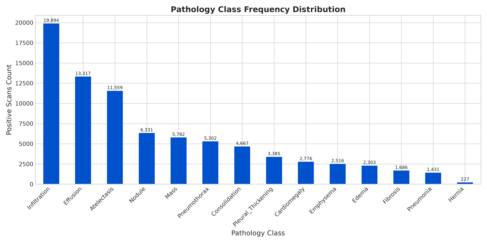
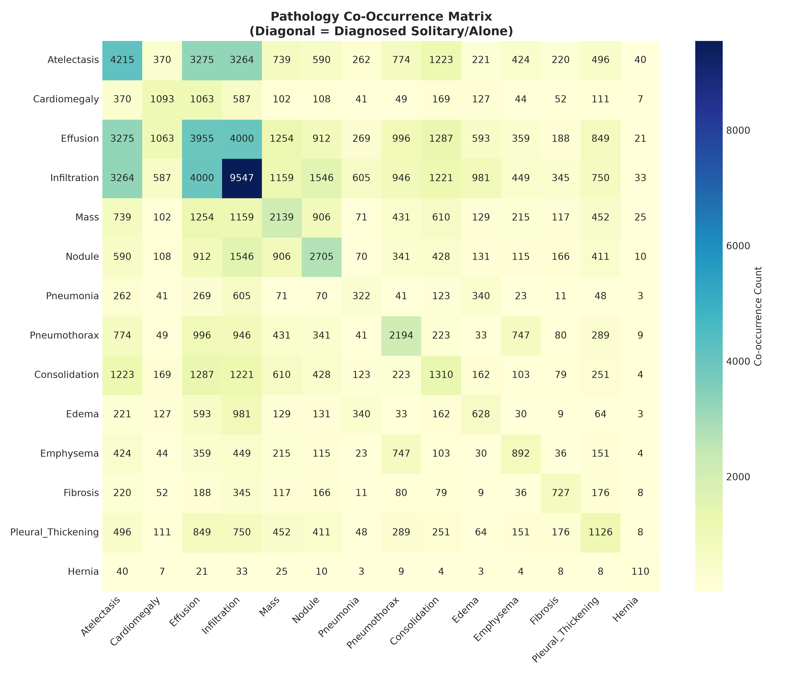
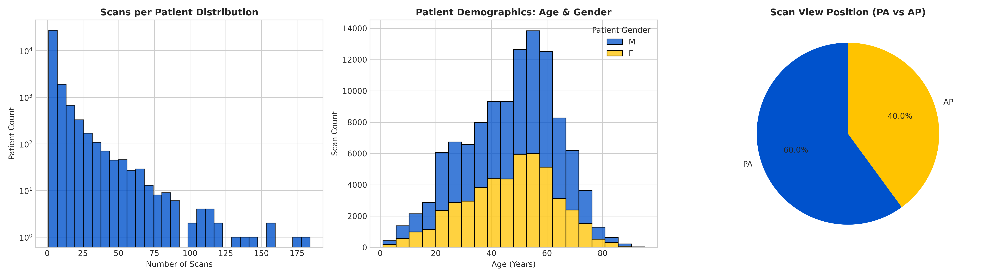

# Dataset and exploratory analysis

Naming, class balance, co-occurrence, and demographics for NIH ChestX-ray14.

The pipeline trains on **NIH ChestX-ray14**: 112,120 frontal chest radiographs
from 30,805 unique patients. The dataset labels are mined from radiology reports
and are noisy. `No Finding` is the majority label (60,361 images), and the
remaining images can carry more than one finding.

## Splitting

The code splits on unique patient IDs. The current default is **70% train / 10%
validation / 10% test**, which gives a held-out test set for final metrics.
Historical artifacts in this repository used an **80/20 train/validation**
split. Setting `--val-fraction 0.2 --test-fraction 0.0` reproduces that split
for `seed=42`.

The official NIH `train_val_list.txt` / `test_list.txt` image-level split is not
used because it has patient overlap. Any comparison to CheXNet's official-test
numbers is therefore approximate.

## Class distribution

| Pathology class | Positive scans | Prevalence |
| :--- | ---: | ---: |
| Infiltration | 19,894 | 17.7% |
| Effusion | 13,317 | 11.9% |
| Atelectasis | 11,559 | 10.3% |
| Nodule | 6,331 | 5.6% |
| Mass | 5,782 | 5.2% |
| Pneumothorax | 5,302 | 4.7% |
| Consolidation | 4,667 | 4.2% |
| Pleural Thickening | 3,385 | 3.0% |
| Cardiomegaly | 2,776 | 2.5% |
| Emphysema | 2,516 | 2.2% |
| Edema | 2,303 | 2.1% |
| Fibrosis | 1,686 | 1.5% |
| Pneumonia | 1,431 | 1.3% |
| Hernia | 227 | 0.2% |



## Co-occurrence matrix

The diagonal of the 14 x 14 co-occurrence matrix isolates **solitary diagnoses**
(pathologies diagnosed alone), while off-diagonal elements measure overlapping
multi-label co-occurrences.



## Demographics and view positions



## Historical performance

These are the 80/20 validation numbers stored in the committed artifacts. They
are not test-set numbers and should be regenerated with the current 70/10/10
pipeline before comparing models.

| Model | Input | Peak AUROC | Peak AUPRC |
| :--- | ---: | ---: | ---: |
| ConvNeXt-Small | 448x448 | 0.8583 | 0.2992 |
| DenseNet-121 | 320x320 | 0.8488 | 0.2812 |

Per-class metrics are generated by:

```bash
python -m src.evaluate --run artifacts/<run> --split test
```

The result is written to `artifacts/<run>/per_class_metrics_test.json`. For an
older run without a test split, use `--split val` and label it as validation.
